<div align="center">


<br/>



# `djlolito@system:~$ whoami`

**BACKEND · AUTOMATIZACIÓN · SISTEMAS**

`[ SISTEMA ACTIVO ]` · `[ ACCESO AUTORIZADO ]`

</div>

---

## `01 // PERFIL`

```text
┌──────────────────────────────────────┐
│           DJLOLITO_OS                │
├──────────────────────────────────────┤
│  ÁREA       Backend / Sistemas       │
│  ENFOQUE    Automatización           │
│  ENTORNO    Desarrollo tecnológico   │
│  ESTADO     Explorando y construyendo│
└──────────────────────────────────────┘
```

Me interesa el desarrollo backend, la automatización y los sistemas. Este perfil reúne mis proyectos, experimentos y aprendizajes dentro del mundo tecnológico.

## `02 // TECNOLOGÍAS`

> Inventario tecnológico en construcción.

Las tecnologías y herramientas se añadirán aquí conforme se definan las que utilizo.

<!-- Añade tus tecnologías reales aquí cuando quieras.
Ejemplo de formato:
- Lenguajes:
- Backend:
- Bases de datos:
- Sistemas:
- Automatización:
- Herramientas:
-->

## `03 // PROYECTOS DESTACADOS`

Consulta mis repositorios para descubrir mis proyectos y experimentos.

<div align="center">

<a href="https://github.com/djlolito?tab=repositories">
  
</a>

</div>

<!-- Añade aquí los proyectos que quieras destacar.
No se muestran proyectos ficticios.
-->

## `04 // ESTADÍSTICAS DEL SISTEMA`

<div align="center">


<br/>


</div>

## `05 // ACTIVIDAD`

<div align="center">


</div>

---

<div align="center">

```text
> INICIALIZANDO SESIÓN...
> USUARIO: DJLOLITO
> CONEXIÓN: ESTABLECIDA
> FIN DE LA TRANSMISIÓN_
```

<sub>CONSTRUIR · AUTOMATIZAR · APRENDER</sub>

</div>
