 <escape><div align="center">




# `djlolito@kaosnet:~$`


**[ SYSTEM ONLINE ] · [ ACCESS GRANTED ] · [ MODE: DEVELOPER ]**

</div>

---

## `01 // WHOAMI`

```bash
┌──(djlolito㉿kaosnet)-[~]
└─$ whoami
```

**ES:** Soy un profesional de IT enfocado en administración de sistemas, infraestructura, redes, automatización y ciberseguridad. Me gusta construir, administrar y optimizar entornos tecnológicos, desde servidores y virtualización hasta servicios cloud y herramientas de monitorización.

**EN:** I'm an IT professional focused on systems administration, infrastructure, networking, automation, and cybersecurity. I enjoy building, managing, and optimizing technology environments, from servers and virtualization to cloud services and monitoring tools.

```bash
└─$ cat /etc/mission
> Automate everything possible.
> Monitor everything important.
> Secure everything exposed.
> Keep learning. Keep building.
```

## `02 // CURRENT OPERATIONS`



- `[+]` **Infrastructure:** Linux, Windows Server, virtualization and server administration.
- `[+]` **Networking:** VLANs, routing, firewalls, VPNs, DNS and reverse proxies.
- `[+]` **Automation:** PowerShell, Bash, scripting and workflow automation.
- `[+]` **Security & Monitoring:** hardening, log analysis, monitoring and troubleshooting.
- `[+]` **Cloud & Services:** hosting, domains, self-hosted services and infrastructure management.

## `03 // TECH STACK`

<div align="center">

**SYSTEMS & VIRTUALIZATION**


**NETWORKING & SECURITY**


**AUTOMATION & MONITORING**


</div>

## `04 // FEATURED PROJECTS`

```text
[ SCANNING REPOSITORIES... ]
[ PROJECTS WILL BE DISPLAYED HERE ]
[ STATUS: READY FOR DEPLOYMENT ]
```

Explore my repositories for infrastructure projects, automation, administration tools and experiments.

<div align="center">

<a href="https://github.com/djlolito?tab=repositories">
  
</a>

</div>

## `05 // GITHUB TELEMETRY`

<div align="center">


</div>

## `06 // CONTRIBUTION MATRIX`

<div align="center">


</div>

## `07 // CONNECT`

<div align="center">

<a href="https://github.com/djlolito">
  
</a>

</div>

---

<div align="center">

```text
root@kaosnet:~# echo "There is no cloud. It's just someone else's computer."
There is no cloud. It's just someone else's computer.

root@kaosnet:~# exit
Connection closed. Keep building.
```


**`[ END OF TRANSMISSION ]`**

</div></escape>
